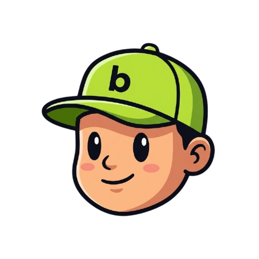
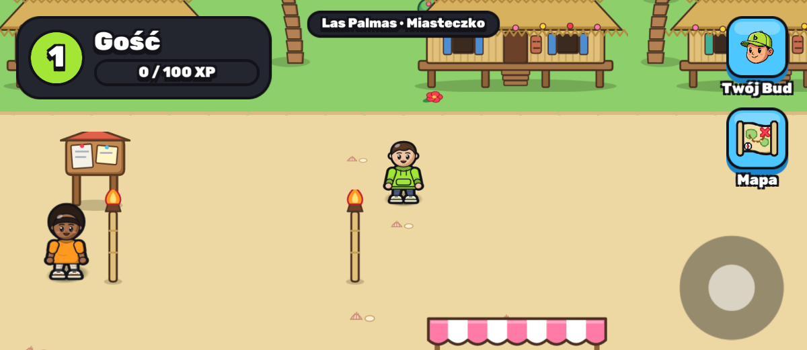
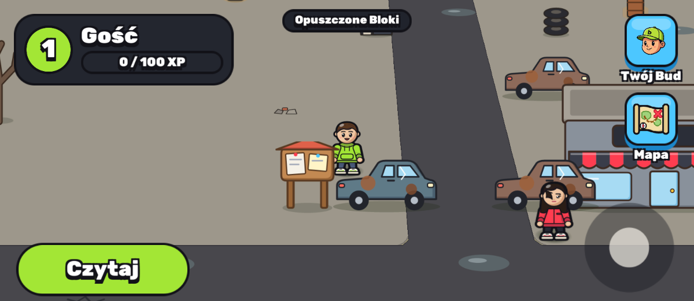
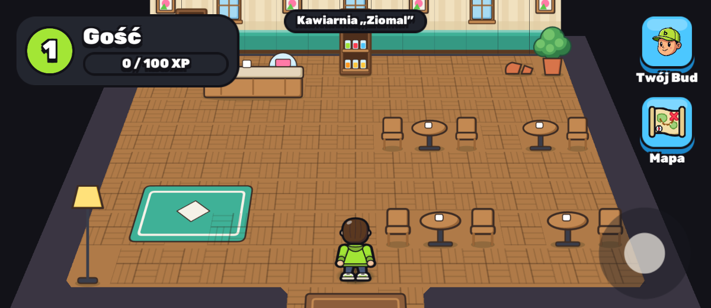
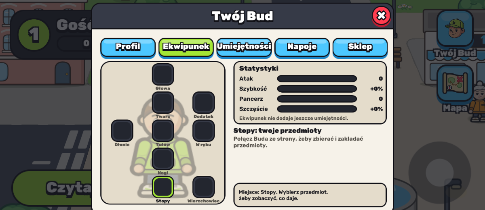
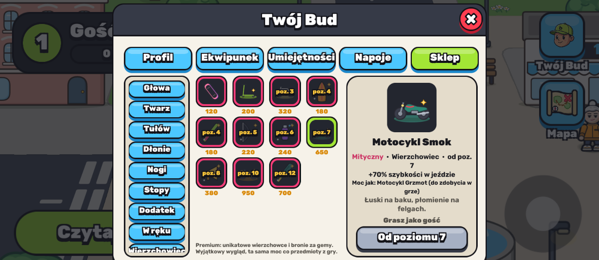
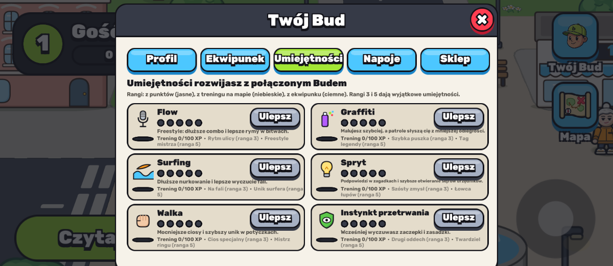
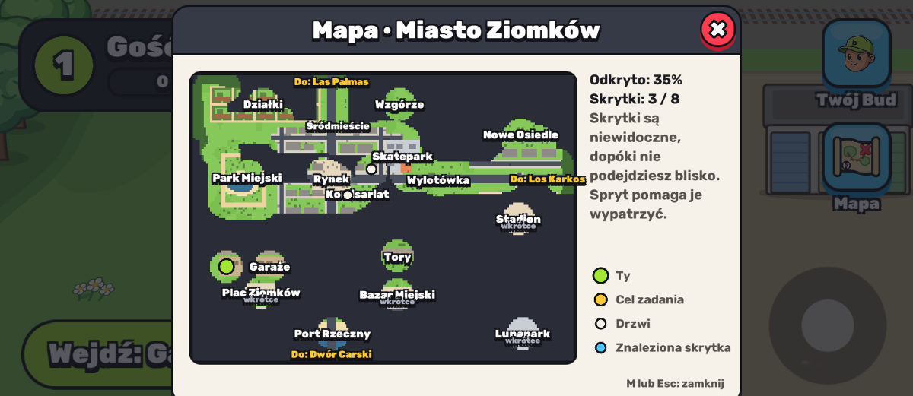
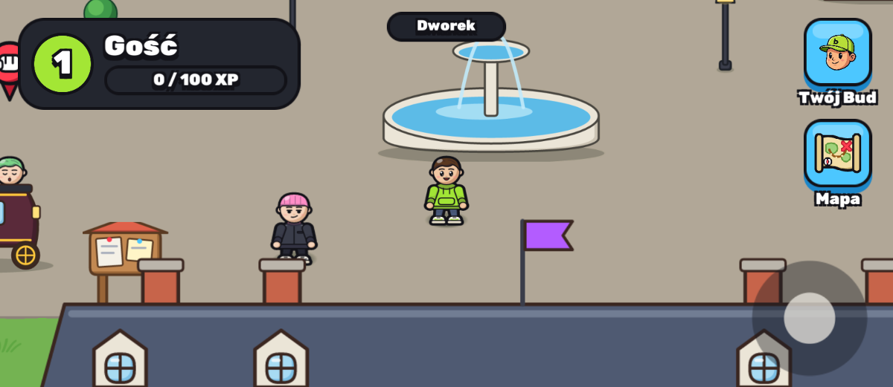

<div align="center">



# Buds

### Twój ziomek. Twoje miasto. Twoja legenda.

Mobilne RPG o ziomkach z miasta: stwórz swojego Buda, rozkręć się w pięciu dzielnicach,<br/>
wygrywaj pojedynki, zbieraj sprzęt i jeźdź po mieście, od deskorolki po quada.

<br/>


<br/>



</div>

<br/>

## Czym jest Buds

Buds to przygoda w świecie, który wygląda jak twoje osiedle, tylko z lepszym słońcem. Zaczynasz na **Wyspie
Startowej**, gdzie Kapitan Bosman uczy cię podstaw, a potem łódź zabiera cię do **Miasta Ziomków**, gdzie zaczyna się
prawdziwa gra. Rozmawiasz z mieszkańcami, bierzesz od nich zadania, odkrywasz ukryte skrytki, trenujesz umiejętności
i zdobywasz szacunek kolejnych dzielnic.

Każdy Bud jest jedyny w swoim rodzaju: ziomek albo ziomeczka, z własnym nastrojem, fryzurą, stylem i kolorami. Nie
wybierasz gotowej postaci, tylko składasz swoją.

<br/>

## Co cię czeka

<table>
<tr>
<td width="50%" valign="top">

**Swój własny Bud**
Kreator w grze i na stronie: płeć, nastrój, odcień skóry, kilkanaście fryzur, bluzy, kurtki, spodnie, spódnice i buty,
każde w swoich kolorach. Wygląd rysuje się na bieżąco, więc twój Bud wygląda tak samo w grze i na stronie.

</td>
<td width="50%" valign="top">

**Pięć dzielnic i wyspa**
Miasto Ziomków ze skateparkiem, stadionem i lunaparkiem, Dzika Puszcza z obozowiskiem, jeziorem i rozbójnikami,
tropikalne Las Palmas z dżunglą i wodospadem, wytworny Dwór Carski z labiryntem i starym młynem oraz niebezpieczne
Los Karkos z ringiem, kopalnią i torem motocrossowym. Do tego wnętrza budynków, do których wchodzisz.

</td>
</tr>
<tr>
<td valign="top">

**Mieszkańcy i zadania**
31 mieszkańców, 33 zadania, każde z własną historią: od dostarczania paczek po tropienie śladów w parku. Nagrody
w doświadczeniu, monetach i przedmiotach.

</td>
<td valign="top">

**Pojedynki turowe**
22 przeciwników z własnym stylem walki. Ruchy zależą od tego, co trzymasz w ręku: kij to zamach i młyniec, procarka
to strzał i seria, mikrofon to diss i drop. Wygrane dają łup, od zwykłego po legendarny.

</td>
</tr>
<tr>
<td valign="top">

**Ekwipunek od stóp do głów**
Ponad 100 przedmiotów w dziewięciu miejscach na postaci, od czapki po pojazd. Każdy coś daje: atak, szybkość,
pancerz, szczęście albo rangę umiejętności. Zakładasz je na sylwetce Buda i od razu widzisz efekt.

</td>
<td valign="top">

**Umiejętności i trening**
Flow, Graffiti, Surfing, Spryt, Walka i Instynkt przetrwania. Rozwijasz je punktami z poziomów i treningiem na mapie:
worek bokserski, scena freestyle, ściana pod graffiti. Rangi 3 i 5 odblokowują wyjątkowe umiejętności, m.in. ciosy
specjalne w pojedynkach.

</td>
</tr>
<tr>
<td valign="top">

**Pojazdy**
Deskorolka, hulajnowa, rower, e-hulajnowa, motocykl i quad. Każdy kolejny jest szybszy, a te najmocniejsze trzeba
zdobyć w walce.

</td>
<td valign="top">

**Napoje energetyczne**
Turbo, Siła, Pancerz, Fart, Skupienie i Regeneracja: krótkie wzmocnienia przed trudną walką albo treningiem.

</td>
</tr>
<tr>
<td valign="top">

**Skrytki i mapa**
Po mieście rozsianych jest 27 skrytek, niewidocznych, dopóki nie podejdziesz blisko. Mapa skarbów odkrywa się
w miarę, jak zwiedzasz.

</td>
<td valign="top">

**Uczciwa gra**
Monety zarabiasz tylko w grze. Za prawdziwe pieniądze kupisz unikatowy wygląd, np. Motocykl Smok czy Kij Neon, ale
zawsze z dokładnie tą samą mocą co przedmiot do zdobycia w grze. Portfel nie wygrywa pojedynków.

</td>
</tr>
</table>

<br/>

## Zobacz grę

<table>
<tr>
<td width="50%"><br/><sub><b>Los Karkos.</b> Opuszczone bloki, złomowisko i ring.</sub></td>
<td width="50%"><br/><sub><b>Wnętrza.</b> Wchodzisz do kawiarni, garażu czy komisariatu, a w środku czekają skrytki.</sub></td>
</tr>
<tr>
<td><br/><sub><b>Ekwipunek.</b> Każde miejsce na sylwetce Buda i statystyki, które daje sprzęt.</sub></td>
<td><br/><sub><b>Sklep.</b> Kategorie po lewej, przedmioty w środku, szczegóły po prawej.</sub></td>
</tr>
<tr>
<td><br/><sub><b>Umiejętności.</b> Punkty z poziomów, rangi z treningu i odblokowane umiejętności specjalne.</sub></td>
<td><br/><sub><b>Mapa.</b> Odkrywa się w miarę zwiedzania, ze skrytkami i celami zadań.</sub></td>
</tr>
<tr>
<td><br/><sub><b>Dwór Carski.</b> Aleje, fontanny i urzędnicy, którzy wiedzą więcej, niż mówią.</sub></td>
<td valign="middle" align="center">

**Graj tak, jak lubisz**

Na telefonie: joystick w rogu ekranu<br/>i jeden przycisk akcji.

Na komputerze: klawiatura (WASD, E, I, M).

</td>
</tr>
</table>

<br/>

## Jak zagrać

1. **Pobierz grę.** Buds jest w fazie wczesnego dostępu na Androida, a premiera w Google Play jest w drodze.
2. **Stwórz Buda.** Zrób to w grze albo na stronie, a jeśli wolisz od razu biegać, wybierz grę jako gość.
3. **Załóż konto na stronie.** Twój Bud, postępy, ekwipunek i monety przetrwają zmianę telefonu. Masz już Buda
   z gry? W panelu „Twój Bud” wybierz „Połącz z kontem” i wpisz kod na stronie.

<br/>

<div align="center">

| 5 dzielnic + wyspa + 4 pustkowia | 85 mieszkańców | 54 zadania | 46 przeciwników | 100+ przedmiotów | 6 pojazdów |
| :------------------------------: | :------------: | :--------: | :-------------: | :--------------: | :--------: |

</div>

<br/>

---

<details>
<summary><b>Dla deweloperów</b></summary>

<br/>

| Część             | Technologia                                                           |
| ----------------- | --------------------------------------------------------------------- |
| `apps/unity`      | Gra: Unity 6.6, URP 2D, kamera 2.5D, Android (iOS w planach)          |
| `apps/web`        | Strona: Next.js 15 na Vercel (kreator, profil, ranking, konta)        |
| `apps/api`        | API: Hono na Render (Budy, zadania, pojedynki, sklep, arkusze PNG)    |
| `packages/shared` | Generator wyglądu Budów, treści gry, zasady walki, schematy zod       |
| `supabase`        | Baza i konta: migracje z RLS, atomowe funkcje SQL                     |
| `tools`           | Eksport grafiki, map i treści do Unity, testy migracji, build na tel. |

Wszystko, co ma wartość (XP, monety, przedmioty, wyniki walk), przyznaje wyłącznie serwer. Gra tylko zgłasza zdarzenia.

```bash
cp .env.example .env
pnpm install
pnpm dev            # strona http://localhost:3000, API http://localhost:4000
pnpm lint && pnpm typecheck && pnpm test
pnpm phone          # build APK i instalacja na telefonie przez Wi-Fi
```

Gra: otwórz `apps/unity` w Unity Hub (Unity 6.6) i uruchom scenę `Assets/Buds/Scenes/Main.unity`.

Więcej: [architektura](docs/architecture.md) · [wdrożenie](docs/deployment.md) · [telefon](docs/telefon.md) ·
[dzielnice](docs/districts.md) · [zadania](docs/questy.md) · [pojedynki](docs/pojedynki.md) ·
[ekwipunek](docs/ekwipunek.md) · [umiejętności](docs/umiejetnosci.md) · [plan prac](docs/roadmap.md)

</details>

<br/>

<div align="center">
<sub>Buds © 2026. Wszystkie postacie, marki i miejsca w grze są wymyślone.</sub>
</div>
